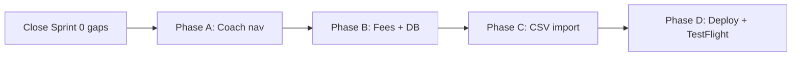

# MCCC Academy — MVP Early Deployment Plan

**Purpose:** Ship a coach-facing MVP **today** (2026-07-09) with navigation, fees, CSV import, and production distribution. This document is **separate** from `SPRINT_PLAN.md` — revisit that file later for the full roadmap.

**Last updated:** 2026-07-09

**Ownership for today:** **AI implements everything** — application code, migrations, infra config, deploy scripts, and DevSecOps execution. You will re-verify and harden later when you have time (`SPRINT_PLAN.md` DevSecOps sections still apply as a follow-up checklist).

---

## MVP scope (in vs out)

### In scope today

| # | Feature | Source sprint | MVP bar |
|---|---------|---------------|---------|
| 1 | **Coach navigation menu** | Sprint 1.5 | Persistent menu on all coach `(tabs)` screens; branch switcher; role-aware admin links |
| 2 | **Academy-wide fees dashboard** | Sprint 1 | All pending/partial invoices; overdue + due-soon highlighting; tap → student profile |
| 3 | **CSV bulk import + column mapping** | Sprint 4 (v1) | Admin upload, preview, flexible header mapping, dry run + commit; branches/batches/students/enrollments |
| 4 | **Production deployment** | Sprint 8 | Docker Face API (HTTPS), EAS production build, TestFlight external (coaches) |

### Explicitly out of scope today

Defer to `SPRINT_PLAN.md` when you have time:

- Student portal (Sprints 5–6)
- 300-user load tuning (Sprint 3)
- Face API deep hardening (Sprint 0.5) — MVP minimum: JWT auth + HTTPS + `DEBUG_ENROLL_IMAGES=0`
- CSV v2 (payments, attendance history — Sprint 7)
- Single-batch enrollment cleanup (Sprint 2)
- Separate Supabase prod project — optional; shared project OK for today (`ENVIRONMENTS.md`)

---

## AI owns everything today

| Area | AI does now | You do later (when you have time) |
|------|-------------|-----------------------------------|
| App features | Phases A–C | UX polish, design preferences |
| Migration SQL | Write + **apply via Supabase MCP** | Re-run security advisor; prod cutover to new project |
| Docker / Fly.io / Railway | Dockerfile, `fly.toml`, deploy scripts, run deploy if CLI creds available | Review hosting, WAF, rate limits (Sprint 0.5) |
| EAS / TestFlight | `eas.json`, secrets docs, build/submit scripts, run if EAS logged in | Apple account hygiene, branch protection, pen tests |
| CI/CD | GitHub Actions for Docker + CI | Require checks on PRs, Dependabot review |
| Smoke tests | curl/API checks, document E2E steps | Dogfood with real coaches for a week |

### Only you can unblock (minimal — paste creds or approve prompts)

AI will run commands and use MCP where the environment allows. If a step stalls, you may need to **once**:

- Approve a terminal command (Fly deploy, `eas build`, `eas submit`)
- Paste an API token if not already in env (`FLY_API_TOKEN`, `EXPO_TOKEN`, Supabase service role in `server/.env`)
- Click through Apple Developer / App Store Connect if EAS submit needs 2FA on your machine

No standing requirement for you to manually do the full DevSecOps checklist today.

---

## Prerequisites (Sprint 0)

| Prerequisite | Status | AI action today |
|--------------|--------|-----------------|
| Coach JWT on Face API routes | ✅ Code done | Verify on deployed HTTPS host |
| Client token forwarding | ✅ Done | — |
| Migrations applied | ✅ Done | Apply Phase B + C migrations via MCP |
| EAS Secrets | ❌ | Document + set via `eas secret:create` or env in `eas.json` |
| Face API on HTTPS | ❌ | Docker build + Fly.io deploy |
| `DEBUG_ENROLL_IMAGES=0` on host | ❌ | Set in Fly/Railway secrets |
| Cleartext off in prod builds | ⚠️ Partial | Fix `app.config.js` |
| Apple Developer Program | Unknown | Proceed with EAS; surface blocker if account missing |

---

## Execution order (AI runs end-to-end)



AI should implement Phases A–C in code first, then Phase D (deploy) once features compile. Sprint 0 gaps (app.config, migrations, Docker) can start in parallel with Phase A.

---

## Today’s timeline (AI-driven)

| Block | Focus |
|-------|-------|
| **Block 1** | Sprint 0 gaps: `app.config.js`, migration apply, Dockerfile scaffold |
| **Block 2** | Phase A — coach nav + branch context |
| **Block 3** | Phase B — fees screen + RPC/index migration (apply via MCP) |
| **Block 4** | Phase C — import UI + server route + audit migration (apply via MCP) |
| **Block 5** | Phase D — Docker build, Fly deploy, EAS secrets, production build, TestFlight submit |
| **Block 6** | Smoke tests + `DEPLOYMENT.md` with URLs, build IDs, rollback notes |

---

## Phase A — Coach navigation menu

**Goal:** Unified UI to reach batches, branch switching, fees, admin tools, and logout.

### AI implements (code + verify)

| Item | Details |
|------|---------|
| **Branch context** | React context: `branch_id`, `branch_name`; persist across screens |
| **Menu component** | `CoachMenu` drawer or slide-over — landscape-friendly |
| **Layout integration** | All `(tabs)` after login; not on auth-only routes |
| **Menu entries** | Table below |
| **Branch switcher** | Change branch without logout; refreshes `Batch_Screen` |
| **Role-aware items** | Hide admin-only links for non-admin coaches |
| **Logout** | Clear session → `/login` |
| **Smoke test** | Dev/simulator: menu open, branch switch, admin gating |

### Menu structure

| Menu item | Route / action | Availability |
|-----------|----------------|--------------|
| **Home** | `/(tabs)` | All coaches |
| **Switch branch** | Branch picker → `Batch_Screen` | All coaches |
| **Batches** | `Batch_Screen` (current branch) | All coaches |
| **Fees** | `Fees.tsx` | All coaches |
| **Coach requests** | `Coach_Requests` | Admin only |
| **Manage coaches** | `Manage_Coaches` | Admin only |
| **Import data** | `Import_Data.tsx` | Admin only |
| **Log out** | Sign out | All coaches |

### You verify later

- Menu on physical iPad via TestFlight
- Two accounts: admin vs non-admin visibility

### Acceptance criteria

- [ ] Menu opens from any main coach screen
- [ ] Branch switch without re-login
- [ ] Batches, Fees, Import (admin), admin tools reachable
- [ ] Admin-only items hidden for non-admin coaches
- [ ] Logout works

---

## Phase B — Academy-wide fees dashboard

**Goal:** Pending fees with **overdue** and **due soon** (within 3 days) highlighting.

### AI implements (code + DB + verify)

| Item | Details |
|------|---------|
| **Screen** | `client/app/(tabs)/Fees.tsx` |
| **Migration** | Indexes on `invoices`; optional `list_pending_fees` RPC — **apply via Supabase MCP** |
| **Filters** | `unpaid` / `partial`; academy-wide for admins |
| **Status logic** | Overdue = past `due_date`; due soon = within 3 days |
| **UI** | Sort overdue → due soon → rest; student, branch, batch, amount, due date, balance |
| **Actions** | Tap row → `Student_Profile` |
| **Navigation** | Coach menu link |
| **RLS check** | Query as coach context; confirm no cross-role leak |

### You verify later

- Security advisor re-run after migration
- Performance with large invoice counts (Sprint 3)

### Acceptance criteria

- [ ] Pending fees visible with correct scope
- [ ] Overdue and due-soon visually distinct
- [ ] Tap opens student payment flow
- [ ] Reachable from coach menu

---

## Phase C — CSV bulk import with flexible column mapping

**Goal:** Upload CSV, map columns, preview, dry-run, commit.

**v1 scope:** Branches, batches, students, batch membership. **Defer:** payments, attendance (Sprint 7).

### AI implements (code + DB + deploy + verify)

| Item | Details |
|------|---------|
| **Screen** | `Import_Data.tsx` — picker, preview, mapping UI |
| **Column mapping** | Headers → canonical fields; save/load mapping template |
| **Import engine** | Server route (admin JWT + service role) — FK order below |
| **Validation** | Row-level errors; dry run + commit modes |
| **Audit log** | Migration for `import_audit_log` — **apply via MCP** |
| **Deploy** | Route live on same Docker host as Face API |
| **Auth test** | Non-admin JWT → 403 |
| **Sample test** | Dry run + commit with sample CSV rows |

### Import order

```
1. branches → 2. fee_plan_templates (if needed) → 3. batches → 4. batch_schedule
5. students → 6. batch_members → 7. custom plans / fee enrollments
8. student_auth — skip (re-capture in app)
```

### You verify later

- Import real full MCCC CSV and spot-check data
- Audit log review

### Acceptance criteria

- [ ] Map columns → dry run → commit works
- [ ] Students appear in correct batches
- [ ] Failed rows reported; successes kept
- [ ] Admin menu only

---

## Phase D — Production deployment

**Goal:** Docker Face API (HTTPS), EAS production build, TestFlight for coaches.

### Architecture

| Component | Deploy how |
|-----------|------------|
| **Mobile** | EAS Build + Submit |
| **Database + Auth** | Supabase Cloud (shared project OK today) |
| **Face API + import** | Docker on Fly.io (primary) or Railway |

### AI implements (infra + deploy + mobile)

| Item | Details |
|------|---------|
| **`server/Dockerfile`** | `face_recognition` deps; non-root; port 8080 |
| **`server/.dockerignore`** | Exclude secrets, debug dumps |
| **`fly.toml` / Railway config** | App name, health check, env var placeholders |
| **`GET /health`** | Fly/Railway health checks |
| **`docker-compose.yml`** | Local parity |
| **Deploy scripts** | `scripts/deploy-api.sh` (or `.ps1` for Windows) |
| **`DEPLOYMENT.md`** | URLs, secrets names, rollback |
| **`app.config.js`** | Prod: cleartext off; name `MCCC Academy`; camera strings |
| **`eas.json`** | Production profile + submit config |
| **EAS secrets** | Set `EXPO_PUBLIC_*` to HTTPS API + Supabase |
| **Docker build + deploy** | Fly.io/Railway with `DEBUG_ENROLL_IMAGES=0` |
| **HTTPS verify** | `/health`, 401 without JWT on `/enroll` |
| **Migrations** | All applied (Phase B + C) via MCP |
| **Demo coach** | Bootstrap `appreview` account script |
| **Privacy policy** | `docs/PRIVACY_POLICY.md` + hostable markdown (GitHub Pages ready) |
| **App Review notes** | Template in `DEPLOYMENT.md` |
| **EAS build** | `eas build --platform ios --profile production` |
| **TestFlight submit** | `eas submit --platform ios` |
| **CI** | GitHub Actions: lint + Docker build on `main` |

### TestFlight strategy (coach MVP)

| Approach | Today |
|----------|-------|
| **TestFlight external** | Target — invite link for coaches |
| **TestFlight internal** | Fallback if external review pending |
| **App Store public** | Defer |
| **Android internal APK** | Optional |

### You verify later

- Apple Developer billing / membership renewal
- Fly.io scaling and WAF (Sprint 0.5)
- 1-week coach dogfood
- Full App Store checklist in `SPRINT_PLAN.md` Sprint 8

### Acceptance criteria — MVP done today

**Infrastructure**

- [ ] Face API in Docker with HTTPS
- [ ] `DEBUG_ENROLL_IMAGES=0` on host
- [ ] Health check passes

**Mobile**

- [ ] Production build uses Supabase + HTTPS API (not LAN)
- [ ] TestFlight build submitted
- [ ] Coach menu live in build

**Features**

- [ ] Fees dashboard on device/build
- [ ] CSV import tested (sample or real file)
- [ ] No service role key in app bundle

---

## AI prompt template (full MVP — copy once)

```text
Implement the full MVP from MVP_EARLY_DEPLOYMENT.md (Phases A–D + Sprint 0 gaps).

Rules:
- AI owns ALL work today — code, migrations, infra config, deploy scripts, and DevSecOps execution.
- Apply migrations via Supabase MCP (do not leave SQL unapplied).
- Build and deploy Docker Face API to Fly.io or Railway; set DEBUG_ENROLL_IMAGES=0.
- Fix app.config.js for production (no cleartext, app display name, camera strings).
- Configure EAS secrets and run production iOS build + TestFlight submit if EAS CLI is available.
- Run smoke tests (API curl, compile, lint).
- Write DEPLOYMENT.md with all URLs, commands, and rollback steps.
- Do NOT edit SPRINT_PLAN.md.
- At the end: list anything that blocked on missing credentials (Fly token, EAS login, Apple 2FA) and exact one-line fixes for me.
- Add a short "Verify later" section referencing SPRINT_PLAN.md DevSecOps for when I have time.
```

---

## End-of-day validation (AI runs where possible)

1. `curl https://<api-host>/health` → 200
2. `curl POST /enroll` without JWT → 401
3. Client lint + typecheck pass
4. Login → menu → branch → batch → students
5. Menu → Fees → overdue/due-soon → tap student
6. (Admin) Import → sample CSV → dry run → commit
7. Face enroll / attendance over HTTPS

---

## If time runs short — cut list

Keep at top; cut from bottom:

1. **Never cut:** HTTPS Docker API, JWT auth, coach navigation menu
2. **Never cut:** EAS production build (TestFlight submit can wait on Apple review)
3. **Cut last:** CSV mapping templates
4. **Cut if needed:** CSV dry-run UI polish
5. **Cut if needed:** Fees RPC — client query + indexes
6. **Defer:** Android path
7. **Defer:** Separate Supabase prod project

---

## Relationship to `SPRINT_PLAN.md`

| This MVP | Full plan (your later pass) |
|----------|----------------------------|
| Phase A | Sprint 1.5 |
| Phase B | Sprint 1 |
| Phase C | Sprint 4 |
| Phase D | Sprint 8 |
| AI did DevSecOps fast | Re-do DevSecOps properly per sprint tables in `SPRINT_PLAN.md` |

When you have time, walk `SPRINT_PLAN.md` DevSecOps sections and treat this deploy as **speed-run** — not the final hardened state.

---

## Changelog

| Date | Change |
|------|--------|
| 2026-07-09 | Created MVP early deployment plan |
| 2026-07-09 | Shifted all DevSecOps to AI for same-day deploy; user verification deferred |
