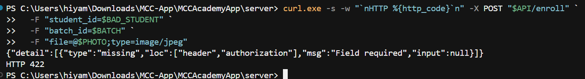
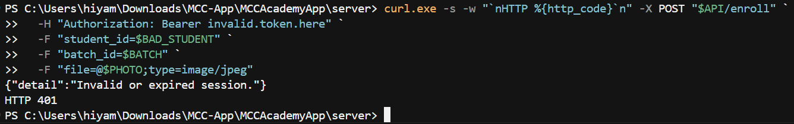
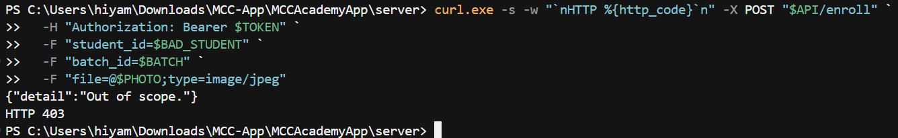
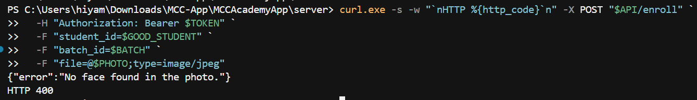
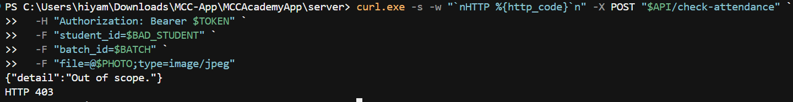
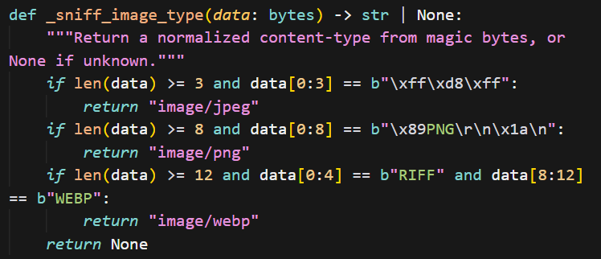
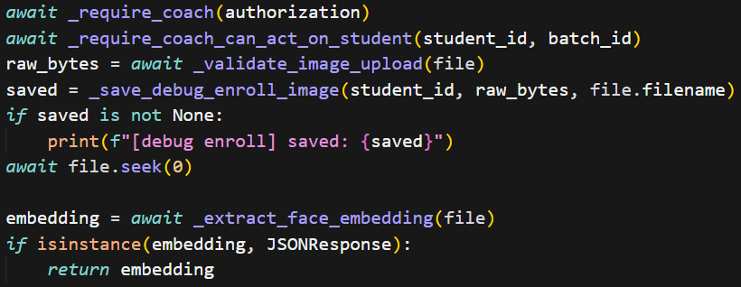
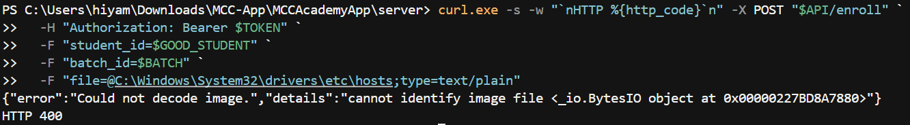
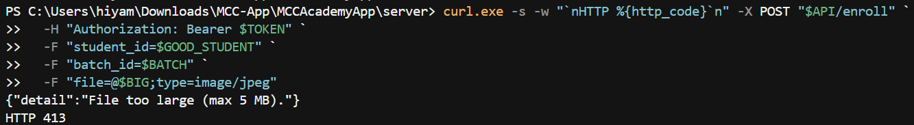
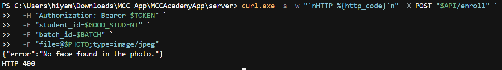

# Security Audit Lab — Phase A

**Purpose:** Track what you did *and* prove you understand it. Treat each section like a lab write-up. Do not check a box until you can answer that section’s questions out loud without looking at notes for ~30 seconds.

**How to use**

1. Fill **Design** before you write code.
2. After each step: record **Evidence**, then answer **Lab questions** in full sentences (not one-word answers).
3. End with **Teach-backs** and **Residual risks**.
4. Never paste real JWTs, service-role keys, or student PII here — use redacted IDs (`student_id=…aaa1`).

| Field | Value |
|-------|-------|
| Start date |07/28/2026 |
| End date |07/28/2026 |
| Environment tested | (local) / staging | UPDATE ONCE COMMITED
| API base URL used | |
| Advisor export filename | |
| Migration filename(s) | |

---

## Phase A checklist

- [DONE] A0 Design note complete
- [DONE] A1 Leaked password protection
- [DONE] A2 Object-level AuthZ
- [ ] A3 Upload limits
- [ ] A4 Debug enroll images off
- [ ] A5 `student_auth` RLS
- [ ] A6 `face_api_audit_log`
- [ ] A7 Cleartext only in development
- [ ] A8 Security Advisor re-export + triage
- [ ] Final teach-backs + residual risks

---

## A0 — Design lab (do this BEFORE coding)

### What to write

**Assets in scope for Phase A**

1. Coach sessions: Making sure the person who is trying to call the Face API is authorized to do so.
2. Face enrollment feature / Attendance API actions: Enforcing who can enroll or mark attendence for which studen_id/batch_id
3. Face embendings: Making sure that face data is secured at rest
4. Enrollment photos both in transit and on disk: Making sure that uploads and anything saved under debug enroll is secured
5. Audit train of face actions: Keeping the integrity of who did what
6. API transit configuration: Making sure that cleartext HTTP is not allowed outside of development

**Attack you are closing (one paragraph)**  
_What could a malicious or curious approved coach do before Phase A?_

> Before Phase A, any approved coach with a valid JWT could call /enroll or /check-attendance with another student’s student_id (and for attendance, a batch they shouldn’t pair them with) because the API only checked coach AuthN, not object-level AuthZ. They could also send huge or non-image uploads and burn CPU on face recognition (DoS). Biometric risk: embeddings may be readable from the client if RLS is weak, and debug enroll mode could leave face images on disk.

**AuthZ rules (your contract)**

```text
/enroll requires:
  - validate coach JWT (AuthN)
  - student_id exists and is an active student
  - student_id is a member of the given batch_id
  else → HTTP 403

/check-attendance requires:
  - valid coach JWT
  - student_id exists, active, and is in batch_id
  else → HTTP 403

Face match failure is NOT the same as AuthZ failure because:
  - AuthX = "may this coach act on this student/batch?" (403 if not)
  - Face match = "does this photo match the selected student?" (ex. 403/404 for mismatch - different control)

Upload policy:
  max bytes: 5242880 (5 MB)
  allowed types: image/jpeg, image/png, image/webp
  reject codes: type → 400   oversize → 413

Debug images:
  default when env unset: OFF
  reason: avoid leaving face photos on disk by accident on staging/shared machines

Audit log must include:
  - who (coach auth user/coach id)
  - action (enroll/check-attendance/authz_deny)
  - student_id, batch_id, success/failure, timestamp
Audit log must NEVER include:
  - raw image bytes, base 64 photos, or face embedding vectors
```

### Lab questions — answer thoroughly

1. What is the difference between **authentication** and **authorization** in this Face API? Give an example of a request that is authenticated but unauthorized.
> Authentication is verifying identity, here, a valid coach JWT on the Face API (_require_coach). Authorization is verifying permission for a specific action/object, e.g. this coach may enroll this student_id in this batch_id.
Authenticated but unauthorized example: Authorization: Bearer <valid_coach_jwt> on POST /enroll with a student_id who is not in the given batch_id → should be 403. The coach is logged in (AuthN OK) but not allowed to act on that student/batch (AuthZ fail).
2. Why does `_require_coach()` alone fail to stop IDOR on `/enroll`?
> It only answers "is this an approved coach?" It doesn't answer "is this coach allowed to edit this student/batch record?" So any approved coach can pass AuthN and still submit another student's student_id (IDOR). That's why you need a seperate object level check.
3. Why can’t you rely on Supabase RLS alone for `/enroll` and `/check-attendance`? (Hint: which key does the server use?)
> You can't rely on RLS alone because those routes write to the database with the server's SUPABASE_KEY. That key bypasses RLS, so Postgres will not enforce coach/student policies on those calls.
4. Should AuthZ run before or after `face_recognition`? Why (security *and* performance/cost)?
> It should run before because if the action is not allowed to run at all you only find out after the action is already run. From the security aspect, another students record could be edited or the image could contain malicious content because the actions itself is supposed to be forbidden. From the performance/cost perspective, if the file is really large and can cause issues with performance or would be a very costly transaction, it will already run before any checks are made to see if it is even allowed in the first place. 

**Gate:** Do not start coding until questions 1–4 are answered above.

---

## A1 — Leaked password protection

### What you did

| Prompt | Your notes |
|--------|------------|
| Where in Dashboard did you click? |Authentication → Providers → Email → enable Leaked password protection → save |
| Was it already on or did you enable it? |No |
| Date completed |7/28/2026 |

### Evidence

- [DONE] Setting confirmed ON

### Lab questions

1. What attack does leaked-password protection reduce? Who is the attacker and what do they try?
> The leaked-password protection reduces attacks where malicious actors use leaked passwords that users have on other platforms to get access to our application.
2. Does this protect Google OAuth coaches the same way as email/password coaches? Explain.
> No it doesn't because Google OAuth is handled fully by Google so our platform has no access to the passwords of user emails that they use to sign in. If a password of their email was leaked supabase would have no way of knowing the leaked password was used for one of their users emails.
3. Name one control that is *still* needed even with this toggle on.
> MFA 

---

## A2 — Object-level AuthZ (IDOR)

### What you implemented

| Item | Your notes (file + function names) |
|------|--------------------------------------|
| Scope helper name |_requre_coach_can_act_on_strudent() |
| How you check batch membership | supabase.table("batch_members").select("student_id, students(status)").eq("batch_id", batch_id) |
| How you check student is allowed (active?) |.select("student_id, students(status)") |
| Where called on `/enroll` |after the requre_coach was returned true: await _require_coach(authorization) |
| Where called on `/check-attendance` |after the requre_coach was returned true: await _require_coach(authorization) |
| Does `/enroll` now require `batch_id`? | yes |

### Design teach-back (2–3 sentences)

_Explain your scope rule like you would to an interviewer:_

> The scope rule was to make sure that the following were true: the coach was authorized to enroll the student or check attendence for that student, the student that we were marking attendence for existed, the batch that the student attendence was marked for existed, and that the student was enrolled in that batch. 

### Evidence table (YOU run these)

| # | Test case | Command or steps (redacted) | Expected | Actual status | Pass? | 
|---|-----------|-----------------------------|----------|---------------|-------|
| 1 | No `Authorization` header | | 401 or 422 |422 |YES |
| 2 | Invalid / expired JWT | | 401 |401 |YES |
| 3 | Valid coach + student **not** in `batch_id` | | **403** |403 |YES |
| 4 | Valid coach + student **in** batch (AuthZ OK; photo may still fail face detect) | | not 403 |400 |YES |
| 5 | `/check-attendance` out-of-scope student | | **403** |403 |YES |

### Proof
#### Test 1

#### Test 2

#### Test 3

#### Test 4

#### Test 5


### Lab questions

1. What is an **IDOR**? Map it to a concrete request against this API.
> IDOR stands for Insecure Direct Object Reference, it is where a user gets access to something they are not authorized to access by manipulated lack of authorization checks. An example of this in this application is a coach who shouldn't have access to enroll a new student, enrolls a new student because the backend did not verify that the coach had the right permissions.
2. Why is **403** the right code for out-of-scope, not **404**? When might you choose 404 instead (enumerate vs hide)?
> 403 is the right code for out-of-scope and not 404 because the 404 error reveals too much to the user about what is going on in the backend. 403 is a forbidden error where as 404 is a not found error, so if an attacker got a 404 error they would know that they had access to the backend they are just querying the wrong batch or student. 
3. If a student is in batch A but you pass batch B, what should happen and why?
> A 403 Forbidden error should show up even though the error is actually that the student was not found in the batch, to keep all errors secure and not leak information it should just say that is a forbidden path.
4. Does face mismatch (`face ≠ selected student`) the same control as AuthZ? Compare the two failures.
> There are not the same failures, face mismatch is an error that happens when the embeddings on the image that came in does not match the student embeddings. The AuthZ is making sure that the person who making the request is allowed to make the request, it has nothing to do with if the student whos attendence is being marked matches the image we are putting in. 
5. If you only checked `batch_id` exists but not membership, what bypass remains?
> If you only verify that batch_id exists (a real batch) but don’t check that student_id is in batch_members for that batch, a coach can still pick any student UUID and pair it with a valid batch. AuthZ would pass even when that student isn’t enrolled in the batch — that’s still an IDOR / object-level bypass. The important check is membership (student belongs to batch), not merely that the batch row exists. 

---

## A3 — Upload limits

### What you implemented

| Control | Value you chose | Where in code |
|---------|-----------------|---------------|
| Max size |5242880 |_MAX_UPLOAD_BYTES = 5 * 1024 * 1024 |
| Allowed MIME / types |jpeg, png, webp | |
| When validation runs (before/after face encode) |before | |

### Evidence

| # | Test case | Expected | Actual | Pass? | Proof |
|---|-----------|----------|--------|-------|-------|
| 1 | Non-image (e.g. `text/plain`) | 400 |400 |YES | |
| 2 | Oversized file (> limit) | 413 | 413|YES | |
| 3 | Valid small JPEG + in-scope student | not 400/413 from upload guard |400 (no face found) |YES | |

### Lab questions

1. What abuse are size limits meant to stop? Be specific for a face-recognition endpoint.
> It is ment to stop DDoS attacks where the feature or system is overloaded with requests causing it to stop working. When a large file is uploaded into the face-recogonition endpoint it takes it longer to extract the embeddings which could potentially cause it to crash. making it unavailable.
2. Why is trusting only the client-sent `Content-Type` weak? What else can you check?
> The client chooses the Content-Type header, so an attacker can label a .exe, text file, or random bytes as image/jpeg. That bypasses a check that only looks at the header. Better: sniff magic bytes (file signature) in the body — e.g. JPEG starts with FF D8 FF, PNG with \x89PNG — so the real format is verified, not the claimed type. (Size limits are a separate control; they don’t fix a lying Content-Type.) 
3. Why reject uploads **before** calling `face_recognition`?
> Face recognition is CPU-heavy. If you decode/run it on huge or non-image uploads first, an attacker can burn server CPU/memory (DoS) before you reject them. Validate size and type first, fail fast with 400/413, and only then call face processing.
4. What status code is conventional for “payload too large,” and what do you return for “wrong type”?
> Payload too large → 413. Wrong / unsupported type (or empty upload) → 400.

---

## A4 — Debug enroll images

### What you changed

| Item | Before | After |
|------|--------|-------|
| Default when env unset | | |
| `server/.env` value | | |
| Deleted `debug_enroll/` files? | yes / no / n/a | |

### Evidence

- [ ] Confirmed no new files appear in `server/debug_enroll/` after a test enroll with debug off
- [ ] Restarted uvicorn after `.env` change

### Lab questions

1. Why is “debug save face images” dangerous on a shared machine or staging server?
2. How is this related to **data minimization** (privacy)?
3. If debug must exist for local troubleshooting, what safeguards would you require (env, path, retention)?

---

## A5 — `student_auth` RLS

### What you wrote / applied

| Item | Notes |
|------|-------|
| Migration file | |
| RLS enabled? | yes / no |
| Can `anon` SELECT embeddings? | |
| Can `authenticated` SELECT embeddings? | |
| Who can write embeddings? | |
| Applied in SQL Editor? | date/time: |

### Evidence

| # | Test | Expected | Actual | Pass? |
|---|------|----------|--------|-------|
| 1 | Coach JWT client: `select face_embedding from student_auth` | deny / empty / error | | |
| 2 | Face API enroll still works (service role) | success path OK | | |
| 3 | `pg_policy` list for `student_auth` recorded below | policies exist | | |

**Policies you observed (paste names only):**

```
```

### Lab questions

1. What does **RLS** enforce, and at what layer (app vs database)?
2. Why must embeddings be blocked from the mobile client even if the UI never shows them?
3. Explain **least privilege** using `anon` vs `authenticated` vs `service_role` for this table.
4. If RLS blocks clients but the Face API uses service_role, what attack still exists without A2?
5. What is a `SECURITY DEFINER` function risk (from Sprint 0 advisor work) in one sentence?

---

## A6 — `face_api_audit_log`

### Schema you shipped

| Column | Purpose |
|--------|---------|
| | |
| | |
| | |
| | |

### Where you write audit rows

| Event | Success logged? | Failure logged? | File/function |
|-------|-----------------|-----------------|---------------|
| AuthZ deny | | | |
| Enroll | | | |
| Attendance | | | |

### Evidence

```sql
-- Paste a redacted query result description (counts / actions only, no PII)
```

| Check | Pass? |
|-------|-------|
| Rows appear after tests | |
| No image bytes / base64 columns | |
| You can tell who did what action at a high level | |

### Lab questions

1. What is **non-repudiation** in this context? How does the audit log help?
2. Why must audit logs omit raw photos and embeddings?
3. If AuthZ denies a request, should you still log it? Why?
4. Who should be allowed to **read** `face_api_audit_log` (coach / admin / service_role only)? Justify.
5. How would a future SOC detection use this table? Give one example rule in plain English.

---

## A7 — Cleartext traffic (mobile)

### What you changed

| File | Change summary |
|------|----------------|
| `client/app.config.js` | |
| `client/eas.json` | |

| Profile | `APP_VARIANT` | Cleartext allowed? |
|---------|---------------|--------------------|
| development | | |
| preview | | |
| production | | |

### Lab questions

1. What attack does HTTPS protect against on a café Wi‑Fi?
2. Why allow cleartext at all in development?
3. What bug existed if cleartext stayed on when `APP_VARIANT` was unset? Why is that dangerous for a “production” local mistake?
4. Does fixing `app.config.js` alone secure a phone that already has an old build installed? What else is required?

---

## A8 — Security Advisor triage

### Exports

| Item | Value |
|------|-------|
| Previous export | `supabase-warning-*.csv` |
| New export filename | |
| Date run | |

### Triage table

| Finding (short) | Severity | New / old / fixed | Decision: fix now / accept | One-line rationale |
|-----------------|----------|-------------------|----------------------------|--------------------|
| | | | | |
| | | | | |
| | | | | |

### Lab questions

1. What is the difference between a **linter/advisor finding** and a **proven exploit**?
2. Pick one finding you **accepted**. Why is accepting sometimes correct?
3. Pick one finding that would be **Critical** if true in production. What would an attacker gain?
4. How often would you re-run the advisor during a 14-day AppSec push? Why?

---

## Cross-cutting evidence — status code fluency

Fill after A2–A3 testing. If you cannot explain a row, re-test.

| Code | Meaning on *this* API | Example request that should return it |
|------|------------------------|----------------------------------------|
| 401 | | |
| 403 | | |
| 400 | | |
| 413 | | |
| 200 | | |

### Lab questions

1. A teammate says “any error can be 400.” Why is that a bad security/product practice here?
2. How do correct status codes help both **security testing** and **SOC detections**?

---

## Final teach-backs (interview gate)

Answer in **your own words**. Aim for 3–5 sentences each.

### T1 — AuthN vs AuthZ

>

### T2 — Why the Face API needs app-layer AuthZ

>

### T3 — Why embeddings must not be client-readable

>

### T4 — Walk me through your IDOR test

_What did you send, what came back, what does that prove?_

>

### T5 — One residual risk you still accept after Phase A

>

---

## Phase A sign-off

| Statement | Initials / date |
|-----------|-----------------|
| I ran the negative tests myself (AI did not “verify” for me) | |
| I can explain every checkbox without reading the code first | |
| `SECURITY_AUDIT.md` has no secrets or real PII | |
| Phase A checklist at top is complete | |

**Phase A result:** PASS / PARTIAL (list gaps): 

>

---

## Appendix — commands scratchpad (redact before sharing)

```powershell
$API = "http://127.0.0.1:8000"
$TOKEN = "<redacted>"
# paste the exact curls you used (token redacted)
```

```sql
-- paste verification queries only
```
