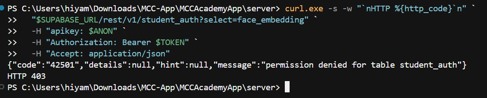
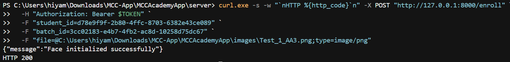
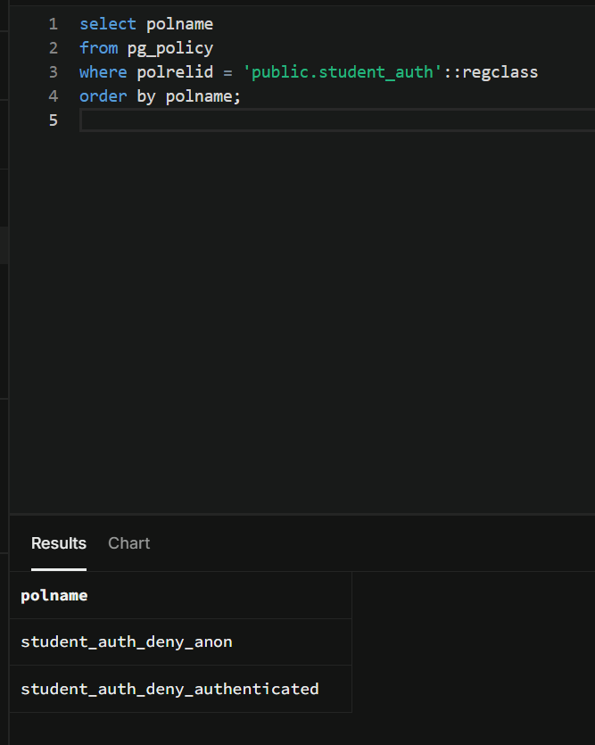
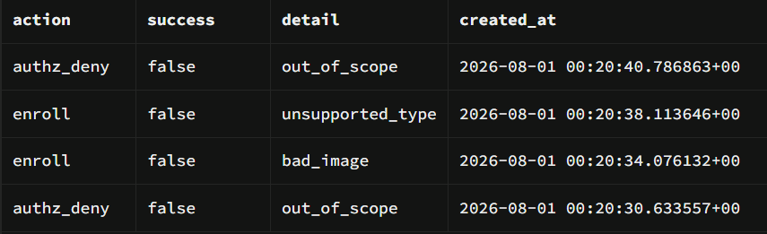

# Security Audit Lab — Phase A & Phase B

**Purpose:** Track what you did *and* prove you understand it. Treat each section like a lab write-up. Do not check a box until you can answer that section’s questions out loud without looking at notes for ~30 seconds.

**How to use**

1. Fill **Design** before you write code / change infra.
2. After each step: record **Evidence**, then answer **Lab questions** in full sentences (not one-word answers).
3. End each phase with **Teach-backs** and **Residual risks**.
4. Never paste real JWTs, service-role keys, or student PII here — use redacted IDs (`student_id=…aaa1`).

---

# Phase A — Close the blast radius

| Field | Value |
|-------|-------|
| Start date |07/28/2026 |
| End date |07/29/2026 |
| Environment tested | (local) / staging | UPDATE ONCE COMMITED
| API base URL used | |
| Advisor export filename | |
| Migration filename(s) | |

---

## Phase A checklist

- [DONE] A0 Design note complete
- [DONE] A1 Leaked password protection
- [DONE] A2 Object-level AuthZ
- [DONE] A3 Upload limits
- [DONE] A4 Debug enroll images off
- [DONE] A5 `student_auth` RLS
- [DONE] A6 `face_api_audit_log`
- [DONE] A7 Cleartext only in development
- [ ] A8 Security Advisor re-export + triage
- [ ] Final teach-backs + residual risks

---

## A0 — Design lab (do this BEFORE coding)

### What to write

**Assets in scope for Phase A**

1. Coach sessions: Making sure the person who is trying to call the Face API is authorized to do so.
2. Face enrollment feature / Attendance API actions: Enforcing who can enroll or mark attendence for which studen_id/batch_id
3. Face embendings: Making sure that face data is secured at rest
4. Enrollment photos both in transit and on disk: Making sure that uploads and anything saved under debug enroll is secured
5. Audit train of face actions: Keeping the integrity of who did what
6. API transit configuration: Making sure that cleartext HTTP is not allowed outside of development

**Attack you are closing (one paragraph)**  
_What could a malicious or curious approved coach do before Phase A?_

> Before Phase A, any approved coach with a valid JWT could call /enroll or /check-attendance with another student’s student_id (and for attendance, a batch they shouldn’t pair them with) because the API only checked coach AuthN, not object-level AuthZ. They could also send huge or non-image uploads and burn CPU on face recognition (DoS). Biometric risk: embeddings may be readable from the client if RLS is weak, and debug enroll mode could leave face images on disk.

**AuthZ rules (your contract)**

```text
/enroll requires:
  - validate coach JWT (AuthN)
  - student_id exists and is an active student
  - student_id is a member of the given batch_id
  else → HTTP 403

/check-attendance requires:
  - valid coach JWT
  - student_id exists, active, and is in batch_id
  else → HTTP 403

Face match failure is NOT the same as AuthZ failure because:
  - AuthX = "may this coach act on this student/batch?" (403 if not)
  - Face match = "does this photo match the selected student?" (ex. 403/404 for mismatch - different control)

Upload policy:
  max bytes: 5242880 (5 MB)
  allowed types: image/jpeg, image/png, image/webp
  reject codes: type → 400   oversize → 413

Debug images:
  default when env unset: OFF
  reason: avoid leaving face photos on disk by accident on staging/shared machines

Audit log must include:
  - who (coach auth user/coach id)
  - action (enroll/check-attendance/authz_deny)
  - student_id, batch_id, success/failure, timestamp
Audit log must NEVER include:
  - raw image bytes, base 64 photos, or face embedding vectors
```

### Lab questions — answer thoroughly

1. What is the difference between **authentication** and **authorization** in this Face API? Give an example of a request that is authenticated but unauthorized.
> Authentication is verifying identity, here, a valid coach JWT on the Face API (_require_coach). Authorization is verifying permission for a specific action/object, e.g. this coach may enroll this student_id in this batch_id.
Authenticated but unauthorized example: Authorization: Bearer <valid_coach_jwt> on POST /enroll with a student_id who is not in the given batch_id → should be 403. The coach is logged in (AuthN OK) but not allowed to act on that student/batch (AuthZ fail).
2. Why does `_require_coach()` alone fail to stop IDOR on `/enroll`?
> It only answers "is this an approved coach?" It doesn't answer "is this coach allowed to edit this student/batch record?" So any approved coach can pass AuthN and still submit another student's student_id (IDOR). That's why you need a seperate object level check.
3. Why can’t you rely on Supabase RLS alone for `/enroll` and `/check-attendance`? (Hint: which key does the server use?)
> You can't rely on RLS alone because those routes write to the database with the server's SUPABASE_KEY. That key bypasses RLS, so Postgres will not enforce coach/student policies on those calls.
4. Should AuthZ run before or after `face_recognition`? Why (security *and* performance/cost)?
> It should run before because if the action is not allowed to run at all you only find out after the action is already run. From the security aspect, another students record could be edited or the image could contain malicious content because the actions itself is supposed to be forbidden. From the performance/cost perspective, if the file is really large and can cause issues with performance or would be a very costly transaction, it will already run before any checks are made to see if it is even allowed in the first place. 

**Gate:** Do not start coding until questions 1–4 are answered above.

---

## A1 — Leaked password protection

### What you did

| Prompt | Your notes |
|--------|------------|
| Where in Dashboard did you click? |Authentication → Providers → Email → enable Leaked password protection → save |
| Was it already on or did you enable it? |No |
| Date completed |7/28/2026 |

### Evidence

- [DONE] Setting confirmed ON

### Lab questions

1. What attack does leaked-password protection reduce? Who is the attacker and what do they try?
> The leaked-password protection reduces attacks where malicious actors use leaked passwords that users have on other platforms to get access to our application.
2. Does this protect Google OAuth coaches the same way as email/password coaches? Explain.
> No it doesn't because Google OAuth is handled fully by Google so our platform has no access to the passwords of user emails that they use to sign in. If a password of their email was leaked supabase would have no way of knowing the leaked password was used for one of their users emails.
3. Name one control that is *still* needed even with this toggle on.
> MFA 

---

## A2 — Object-level AuthZ (IDOR)

### What you implemented

| Item | Your notes (file + function names) |
|------|--------------------------------------|
| Scope helper name |_requre_coach_can_act_on_strudent() |
| How you check batch membership | supabase.table("batch_members").select("student_id, students(status)").eq("batch_id", batch_id) |
| How you check student is allowed (active?) |.select("student_id, students(status)") |
| Where called on `/enroll` |after the requre_coach was returned true: await _require_coach(authorization) |
| Where called on `/check-attendance` |after the requre_coach was returned true: await _require_coach(authorization) |
| Does `/enroll` now require `batch_id`? | yes |

### Design teach-back (2–3 sentences)

_Explain your scope rule like you would to an interviewer:_

> The scope rule was to make sure that the following were true: the coach was authorized to enroll the student or check attendence for that student, the student that we were marking attendence for existed, the batch that the student attendence was marked for existed, and that the student was enrolled in that batch. 

### Evidence table (YOU run these)

| # | Test case | Command or steps (redacted) | Expected | Actual status | Pass? | 
|---|-----------|-----------------------------|----------|---------------|-------|
| 1 | No `Authorization` header | | 401 or 422 |422 |YES |
| 2 | Invalid / expired JWT | | 401 |401 |YES |
| 3 | Valid coach + student **not** in `batch_id` | | **403** |403 |YES |
| 4 | Valid coach + student **in** batch (AuthZ OK; photo may still fail face detect) | | not 403 |400 |YES |
| 5 | `/check-attendance` out-of-scope student | | **403** |403 |YES |

### Proof
#### Test 1

#### Test 2

#### Test 3

#### Test 4

#### Test 5


### Lab questions

1. What is an **IDOR**? Map it to a concrete request against this API.
> IDOR stands for Insecure Direct Object Reference, it is where a user gets access to something they are not authorized to access by manipulated lack of authorization checks. An example of this in this application is a coach who shouldn't have access to enroll a new student, enrolls a new student because the backend did not verify that the coach had the right permissions.
2. Why is **403** the right code for out-of-scope, not **404**? When might you choose 404 instead (enumerate vs hide)?
> 403 is the right code for out-of-scope and not 404 because the 404 error reveals too much to the user about what is going on in the backend. 403 is a forbidden error where as 404 is a not found error, so if an attacker got a 404 error they would know that they had access to the backend they are just querying the wrong batch or student. 
3. If a student is in batch A but you pass batch B, what should happen and why?
> A 403 Forbidden error should show up even though the error is actually that the student was not found in the batch, to keep all errors secure and not leak information it should just say that is a forbidden path.
4. Does face mismatch (`face ≠ selected student`) the same control as AuthZ? Compare the two failures.
> There are not the same failures, face mismatch is an error that happens when the embeddings on the image that came in does not match the student embeddings. The AuthZ is making sure that the person who making the request is allowed to make the request, it has nothing to do with if the student whos attendence is being marked matches the image we are putting in. 
5. If you only checked `batch_id` exists but not membership, what bypass remains?
> If you only verify that batch_id exists (a real batch) but don’t check that student_id is in batch_members for that batch, a coach can still pick any student UUID and pair it with a valid batch. AuthZ would pass even when that student isn’t enrolled in the batch — that’s still an IDOR / object-level bypass. The important check is membership (student belongs to batch), not merely that the batch row exists. 

---

## A3 — Upload limits

### What you implemented

| Control | Value you chose | Where in code |
|---------|-----------------|---------------|
| Max size |5242880 |_MAX_UPLOAD_BYTES = 5 * 1024 * 1024 |
| Allowed MIME / types |jpeg, png, webp | |
| When validation runs (before/after face encode) |before | |

### Evidence

| # | Test case | Expected | Actual | Pass? | Proof |
|---|-----------|----------|--------|-------|-------|
| 1 | Non-image (e.g. `text/plain`) | 400 |400 |YES | |
| 2 | Oversized file (> limit) | 413 | 413|YES | |
| 3 | Valid small JPEG + in-scope student | not 400/413 from upload guard |400 (no face found) |YES | |

### Lab questions

1. What abuse are size limits meant to stop? Be specific for a face-recognition endpoint.
> It is ment to stop DDoS attacks where the feature or system is overloaded with requests causing it to stop working. When a large file is uploaded into the face-recogonition endpoint it takes it longer to extract the embeddings which could potentially cause it to crash. making it unavailable.
2. Why is trusting only the client-sent `Content-Type` weak? What else can you check?
> The client chooses the Content-Type header, so an attacker can label a .exe, text file, or random bytes as image/jpeg. That bypasses a check that only looks at the header. Better: sniff magic bytes (file signature) in the body — e.g. JPEG starts with FF D8 FF, PNG with \x89PNG — so the real format is verified, not the claimed type. (Size limits are a separate control; they don’t fix a lying Content-Type.) 
3. Why reject uploads **before** calling `face_recognition`?
> Face recognition is CPU-heavy. If you decode/run it on huge or non-image uploads first, an attacker can burn server CPU/memory (DoS) before you reject them. Validate size and type first, fail fast with 400/413, and only then call face processing.
4. What status code is conventional for “payload too large,” and what do you return for “wrong type”?
> Payload too large → 413. Wrong / unsupported type (or empty upload) → 400.

---

## A4 — Debug enroll images

### What you changed

| Item | Before | After |
|------|--------|-------|
| Default when env unset | 1 (ON) | 0 (OFF) |
| `server/.env` value | unset | 0 |
| Deleted `debug_enroll/` files? | n/a (no folder/files) | n/a |

### Evidence

- [DONE] Confirmed no new files appear in `server/debug_enroll/` after a test enroll with debug off
- [DONE] Restarted uvicorn after `.env` change

### Lab questions

1. Why is “debug save face images” dangerous on a shared machine or staging server?
> Face photos are biometric data. If debug mode writes them to disk on a shared laptop or staging host, anyone with filesystem access (other users, ops, a later compromise) can copy them. That creates an unnecessary biometric store outside the product’s intended path (embeddings in the DB), often with no access controls or retention policy.
2. How is this related to **data minimization** (privacy)?
> Data minimization means you only collect and keep what you need. Enrollment already needs an image in memory to build an embedding; saving a second copy under `debug_enroll/` is extra retention you do not need for the feature to work. Turning debug off by default avoids holding face images longer (and in more places) than necessary.
3. If debug must exist for local troubleshooting, what safeguards would you require (env, path, retention)?
> Opt-in only via env (`DEBUG_ENROLL_IMAGES=1`), never on staging/prod. Write only to a local path that is gitignored (e.g. `server/debug_enroll/`), not into the repo or shared storage. Delete files as soon as debugging is done (or auto-expire them), and never commit or upload those images.

---

## A5 — `student_auth` RLS

### What you wrote / applied

**Policy Contract**

```
anon           → no SELECT / INSERT / UPDATE / DELETE on student_auth
authenticated  → no SELECT / INSERT / UPDATE / DELETE on student_auth
                (even metadata — prefer no client access at all)
service_role   → Face API may read/write (bypasses RLS; keep GRANTs)
```

| Item | Notes |
|------|-------|
| Migration file |20260729140000_phase_a_student_auth_rls_and_face_audit.sql |
| RLS enabled? | yes |
| Can `anon` SELECT embeddings? |no |
| Can `authenticated` SELECT embeddings? |no |
| Who can write embeddings? |FastAPI (service_role) |
| Applied in SQL Editor? | date: 7/29/26 |

### Evidence

| # | Test | Expected | Actual | Pass? | Proof |
|---|------|----------|--------|-------|-------|
| 1 | Coach JWT client: `select face_embedding from student_auth` | deny / empty / error |403 |YES | |
| 2 | Face API enroll still works (service role) | success path OK |200 |YES | |
| 3 | `pg_policy` list for `student_auth` recorded below | policies exist |Returned student_auth_deny_anon and student_auth_deny_authenticated |YES | |

**Policies you observed (paste names only):**

```
student_auth_deny_anon
student_auth_deny_authenticated
```

### Lab questions

1. What does **RLS** enforce, and at what layer (app vs database)?
> Row Level Security enforces which rows a database role may SELECT/INSERT/UPDATE/DELETE on a table. It runs in **Postgres (database layer)**, not in the React Native UI or FastAPI. The app can hide screens, but RLS is what actually blocks a direct Supabase/PostgREST call.
2. Why must embeddings be blocked from the mobile client even if the UI never shows them?
> “UI never shows it” is not a control. Anyone with the anon key and a coach JWT can call the Supabase REST API directly (curl, modified app, proxy). If `authenticated` can SELECT `face_embedding`, they can exfiltrate biometric templates even though no screen displays them. Defense in depth: block at the database with RLS + grants.
3. Explain **least privilege** using `anon` vs `authenticated` vs `service_role` for this table.
> Give each role only what it needs: `anon` (not logged in) gets **no** access to `student_auth`; `authenticated` (logged-in coaches) also gets **no** access — coaches don’t need embeddings in the client; `service_role` (Face API `SUPABASE_KEY`) alone may read/write embeddings to enroll and match faces. Anything broader than that is excess privilege.
4. If RLS blocks clients but the Face API uses service_role, what attack still exists without A2?
> **IDOR via the Face API:** an approved coach with a valid JWT can still POST `/enroll` or `/check-attendance` with another student’s `student_id` (and a batch pairing they shouldn’t use). `service_role` bypasses RLS, so the DB will accept the write unless the API enforces object-level AuthZ (A2) first.
5. What is a `SECURITY DEFINER` function risk (from Sprint 0 advisor work) in one sentence?
> A `SECURITY DEFINER` function runs with the **owner’s** privileges, so if `anon`/`authenticated` can execute it without tight guards, it can bypass normal RLS and expose or change data the caller should not reach (Sprint 0 revoked several of these from public/anon).

---

## A6 — `face_api_audit_log`

### Schema you shipped

| Column | Purpose |
|--------|---------|
|id |Unique id for each audit |
|created_at |When the event happened |
|coach_id |Which coach (or admin) made the request |
|action |What they tried (enroll, check_attendance, authz_deny) |
|student_id |Which student the request targeted |
|batch_id |Which batch was used for the AuthZ check |
|success | Whether the action succeeded (true/false) |
|detail | Short reason code only (ex. out_of_scope, no_face) |

### Evidence



| Check | Pass? |
|-------|-------|
| Rows appear after tests |Yes |
| No image bytes / base64 columns |Yes |
| You can tell who did what action at a high level |Yes |

### Lab questions

1. What is **non-repudiation** in this context? How does the audit log help?
> Non-repudiation means a coach (or attacker using their account) cannot later credibly deny that an action happened. It is not the same as authentication — AuthN proves "this request had a valid coach JWT"; non-repudiation is the durable record that "coach X did enroll/check-attendance/authz_deny on student Y in batch Z at time T." The `face_api_audit_log` helps by storing who / action / student_id / batch_id / success / detail so you can investigate disputes ("I didn't enroll that face") and abuse after the fact.
2. Why must audit logs omit raw photos and embeddings?
> Audit rows are copied into backups, exports, and later SIEM/SOC tools, and they are kept longer than a single API request. Photos and embeddings are biometric templates — high-value if leaked. Logging only reason codes (e.g. `out_of_scope`, `no_face`) follows data minimization: you keep enough to investigate who did what, without creating a second biometric store inside the audit trail.
3. If AuthZ denies a request, should you still log it? Why?
> Yes. An AuthZ deny is often more security-relevant than a success — it means someone tried an out-of-scope `student_id`/`batch_id` (IDOR probe, confused coach, or stolen JWT misuse). Logging `authz_deny` lets you spot repeated failures from one coach or IP pattern later. If you only logged successes, failed attacks would be invisible.
4. Who should be allowed to **read** `face_api_audit_log` (coach / admin / service_role only)? Justify.
> Coaches (`authenticated`) must not read it from the mobile client — no product need, and it would expose other coaches' activity and targeted student IDs. In our migration, only `service_role` (Face API) may INSERT/SELECT so the API can write rows and you can verify via the server; `anon`/`authenticated` are denied by RLS. Human review should be admin-only through a privileged path (SQL Editor / future admin API), not every coach JWT. The Face API writes the log; broad client read access would defeat least privilege.
5. How would a future SOC detection use this table? Give one example rule in plain English.
> Example rule: "Alert if the same `coach_id` produces 20 or more `authz_deny` rows within 10 minutes" — that pattern looks like IDOR probing or a misused token, and should page someone to suspend the coach and inspect recent enroll/attendance rows for that account.
---

## A7 — Cleartext traffic (mobile)

### What you changed

| File | Change summary |
|------|----------------|
| `client/app.config.js` |Updated code to: usesCleartextTraffic: process.env.APP_VARIANT === 'development', |
| `client/eas.json` |Added env block to each build profile |

| Profile | `APP_VARIANT` | Cleartext allowed? |
|---------|---------------|--------------------|
| development |development |yes |
| preview |preview |no |
| production |production |no |

### Lab questions

1. What attack does HTTPS protect against on a café Wi‑Fi?
> HTTPS protects against **eavesdropping and man-in-the-middle (MITM)** on untrusted networks (café Wi‑Fi, hostile hotspots). Without TLS, anyone on the same network can sniff or alter traffic — for this app that means coach JWTs, uploaded face photos, and student/batch IDs in transit.
2. Why allow cleartext at all in development?
> Local Face API usually runs as plain HTTP on your LAN (`http://192.168.x.x:8000`) without a real TLS certificate. Dev builds need cleartext so the phone can reach that server during daily development. It is a deliberate tradeoff for local DX — not a reason to leave HTTP on in preview/production.
3. What bug existed if cleartext stayed on when `APP_VARIANT` was unset? Why is that dangerous for a “production” local mistake?
> The fail-open bug: if cleartext was allowed whenever `APP_VARIANT` was missing or not exactly `production`, an unset env (common in local/non-EAS builds) left `usesCleartextTraffic` **on**. That is dangerous because a “prod-like” build could still talk HTTP — so a mistaken LAN or staging URL would send JWTs and face photos in cleartext. The fix (`=== 'development'`) fails closed: unset → cleartext **off**.
4. Does fixing `app.config.js` alone secure a phone that already has an old build installed? What else is required?
> No. `usesCleartextTraffic` is baked into the native build at compile time. Phones already running an old APK/IPA keep the old setting until you **rebuild** (EAS) and **reinstall/update** that build on the device. Changing source alone does nothing for installs already in the field.
---

## A8 — Security Advisor triage

### Exports

| Item | Value |
|------|-------|
| Previous export | `supabase-warning.csv` |
| New export filename | `supabase-warning-phaseA-20260801.csv` |
| Date run | 8/1/26 |

### Triage table

| Finding (short) | Severity | New / old / fixed | Decision: fix now / accept | One-line rationale |
|-----------------|----------|-------------------|----------------------------|--------------------|
| `extension_in_public` (`vector` in `public`) | WARN | old | accept | Standard pgvector layout; moving schema is high-risk for little gain right now |
| `authenticated` can execute SECURITY DEFINER coach helpers (`current_coach_id`, `has_coach_access`, etc.) | WARN | old | accept | Intentional app RPCs; they use `auth.uid()` / internal guards (documented in `ENVIRONMENTS.md`) |
| `authenticated` can execute `list_pending_fees` SECURITY DEFINER | WARN | new | accept | Fees RPC used by signed-in coaches; keep until a later invoker/grant hardening pass |
| `anon` SECURITY DEFINER on admin/coach RPCs | WARN | fixed | — | Sprint 0 revoke migration removed anon execute |
| `public_bucket_allows_listing` on `student-auth-photos` | WARN | fixed | — | Broad storage SELECT policy removed in Sprint 0 |
| `function_search_path_mutable` on `match_face` | WARN | fixed | — | `SET search_path` applied in Sprint 0 migration |
| `admin_insert_coach` / admin password RPCs executable by `authenticated` | WARN | fixed | — | Revoked from app roles; service_role / Face API only |

### Lab questions

1. What is the difference between a **linter/advisor finding** and a **proven exploit**?
> An advisor finding is a static check that a configuration *might* be risky (e.g. SECURITY DEFINER + `authenticated` EXECUTE). It does not prove anyone can abuse it today. A proven exploit is a working attack path you demonstrated — e.g. calling an RPC with anon/JWT and getting unauthorized data or a privileged write. Advisors triage where to look; exploits prove impact.
2. Pick one finding you **accepted**. Why is accepting sometimes correct?
> I accepted `extension_in_public` (`vector` in `public`). Moving pgvector mid-project is high risk for little security gain right now, and the embeddings path is already gated by RLS + service_role. Accepting is correct when risk is low/understood, fix cost is high, and you document revisit criteria (e.g. before prod hardening).
3. Pick one finding that would be **Critical** if true in production. What would an attacker gain?
> The old `anon` / public EXECUTE on `admin_insert_coach` (now fixed) would be Critical in production: anyone with the anon key could create coaches or flip admin-related flags without signing in — full privilege escalation into the academy admin surface.
4. How often would you re-run the advisor during a 14-day AppSec push? Why?
> After every security-relevant migration or grant/RLS change, plus once at the end of the push (roughly every few days if shipping DB fixes). Re-running catches regressions and confirms “fixed” items stay gone; waiting two weeks only is too late to catch something you just broke. 

---

## Cross-cutting evidence — status code fluency

Fill after A2–A3 testing. If you cannot explain a row, re-test.

| Code | Meaning on *this* API | Example request that should return it |
|------|------------------------|----------------------------------------|
| 401 | | |
| 403 | | |
| 400 | | |
| 413 | | |
| 200 | | |

### Lab questions

1. A teammate says “any error can be 400.” Why is that a bad security/product practice here?
2. How do correct status codes help both **security testing** and **SOC detections**?

---

## Final teach-backs (interview gate)

Answer in **your own words**. Aim for 3–5 sentences each.

### T1 — AuthN vs AuthZ

>

### T2 — Why the Face API needs app-layer AuthZ

>

### T3 — Why embeddings must not be client-readable

>

### T4 — Walk me through your IDOR test

_What did you send, what came back, what does that prove?_

>

### T5 — One residual risk you still accept after Phase A

>

---

## Phase A sign-off

| Statement | Initials / date |
|-----------|-----------------|
| I ran the negative tests myself (AI did not “verify” for me) | |
| I can explain every checkbox without reading the code first | |
| `SECURITY_AUDIT.md` has no secrets or real PII | |
| Phase A checklist at top is complete | |

**Phase A result:** PASS / PARTIAL (list gaps): 

>

---

## Appendix A — commands scratchpad (redact before sharing)

```powershell
$API = "http://127.0.0.1:8000"
$TOKEN = "<redacted>"
# paste the exact curls you used (token redacted)
```

```sql
-- paste verification queries only
```

---

# Phase B — Edge, transport, and secrets

| Field | Value |
|-------|-------|
| Start date | |
| End date | |
| Host platform chosen | Fly.io / Railway / other: |
| Staging API URL (HTTPS) | |
| Cloudflare / WAF zone (if any) | |
| Rate-limit thresholds documented in | `ENVIRONMENTS.md` / this file |
| Secrets checklist location | `ENVIRONMENTS.md` |
| Prod Supabase cutover runbook location | |

---

## Phase B checklist

- [ ] B0 Design note complete
- [ ] B1 Face API on HTTPS + `/health`
- [ ] B2 Cloudflare (or host WAF) in front of API
- [ ] B3 Host rate limits on `/enroll` + `/check-attendance`
- [ ] B4 Secrets hygiene checklist written + followed
- [ ] B5 Prod Supabase project cutover runbook
- [ ] B6 Branch protection requires CI on PRs
- [ ] B7 No service-role in client bundle / Expo config
- [ ] Final teach-backs + residual risks

---

## B0 — Design lab (do this BEFORE deploying)

### What to write

**Assets in scope for Phase B**

1. Face API host (Fly/Railway/etc.): TLS termination, health checks, env secrets on the host
2. Edge / WAF layer: who can reach the API from the public internet, bot/rate rules
3. Rate limits on CPU-heavy face routes: per-IP (and optionally per-coach) thresholds
4. Secret inventory: service-role, anon/publishable keys, EAS secrets per profile, local `.env`
5. Environment separation plan: shared free-tier Supabase today → dedicated prod project later
6. GitHub branch protection: CI must pass before merge to protected branches
7. Client binary hygiene: confirm service-role / secret keys never ship in Expo builds

**Attack you are closing (one paragraph)**  
_What could go wrong after Phase A if the API stays on LAN HTTP with no edge controls?_

>

**Deployment + secrets contract (your design)**

```text
Staging Face API:
  - HTTPS only (preview/production mobile builds never call http://)
  - GET /health → 200 without auth (for host health checks only)
  - DEBUG_ENROLL_IMAGES=0 on the host
  - SUPABASE_KEY = service_role/secret — host env only, never in git or Expo

Rate limits (starting point — adjust after you measure):
  - /enroll:            ___ / min / IP
  - /check-attendance:  ___ / min / IP
  - Expected reject code: 429
  - Where enforced: app (slowapi/middleware) and/or edge (Cloudflare)

Secrets rules:
  - Publishable/anon → client + EAS OK
  - Service-role / SUPABASE_KEY → server host only
  - If a secret was pasted in chat/logs → rotate before marking B4 done

Prod Supabase cutover (even if later):
  - New project → run all migrations → bootstrap admin → point production EAS + prod API host
  - Do NOT wipe the shared project while it is still staging+dev
```

### Lab questions — answer thoroughly

1. Why is deploying the Face API on **HTTPS** a different control from Phase A’s cleartext toggle (`usesCleartextTraffic`)?
>
2. What does a **WAF / edge proxy** give you that app-layer AuthZ (Phase A) does not?
>
3. Why rate-limit `/enroll` and `/check-attendance` specifically, not only `/health`?
>
4. If the service-role key leaks into an Expo build or a chat log, what is the blast radius? Name at least two tables/actions an attacker could hit.
>

**Gate:** Do not start hosting/WAF work until questions 1–4 are answered above.

---

## B1 — Face API on HTTPS + health check

### What you implemented / deployed

| Item | Your notes |
|------|------------|
| Host platform | Fly.io / Railway / other: |
| App / service name | |
| Public HTTPS base URL | `https://…` |
| How TLS is provided | platform cert / Cloudflare / other |
| `GET /health` exists? | file + function: |
| Host health-check config | path `/health`, interval: |
| Env vars set on host | `SUPABASE_URL`, `SUPABASE_KEY`, `DEBUG_ENROLL_IMAGES=0`, others: |
| Preview EAS `EXPO_PUBLIC_API_BASE_URL` | points at HTTPS URL? Y/N |

### Evidence

| # | Test case | Command or steps (redacted) | Expected | Actual | Pass? | Proof |
|---|-----------|-----------------------------|----------|--------|-------|-------|
| 1 | `GET /health` over HTTPS | | 200 | | | |
| 2 | `POST /enroll` no token over HTTPS | | 401 or 422 | | | |
| 3 | Preview/prod config has no `http://` API URL | | HTTPS only | | | |
| 4 | Host restarts / health check recovers after kill | | healthy again | | | |

### Lab questions

1. Why should `/health` stay **unauthenticated** while `/enroll` requires a coach JWT?
>
2. What would break if you pointed a **preview** EAS build at your LAN `http://192.168.x.x:8000` after Phase A cleartext is off?
>
3. Where do host secrets live (Fly secrets / Railway variables / etc.), and why must they **not** be committed to git?
>
4. After deploy, how do you confirm `DEBUG_ENROLL_IMAGES` is actually `0` on the host (not just in local `.env`)?
>

---

## B2 — Cloudflare (or host WAF) in front of API

### What you configured

| Item | Notes |
|------|-------|
| Edge product chosen | Cloudflare / Fly WAF / Railway / none yet |
| DNS / proxy mode | orange-cloud / DNS-only / platform-native |
| TLS mode (if Cloudflare) | Full / Full (strict) / Flexible — pick and justify |
| Bot / rate / WAF rules enabled | list rule names briefly |
| Origin still reachable by raw IP/host? | Y/N — if Y, what residual risk? |

### Evidence

| # | Test | Expected | Actual | Pass? | Proof |
|---|------|----------|--------|-------|-------|
| 1 | Browser or curl hits public HTTPS hostname | TLS OK, API responds | | | |
| 2 | At least one edge rule documented (rate, bot, geo, or WAF managed) | rule exists | | | |
| 3 | Screenshot or export of rule list (no account secrets) | saved under `images/` or notes | | | |

### Design teach-back (2–3 sentences)

_Explain to an interviewer why the Face API should not be a naked origin on the open internet:_

>

### Lab questions

1. What is the difference between **TLS to the edge** and **TLS to the origin**? Why is “Flexible” TLS dangerous?
>
2. Name one attack AuthZ will not stop that a WAF/rate rule might blunt (e.g. volumetric abuse).
>
3. If Cloudflare is DNS-only (grey cloud), what protection are you *not* getting?
>
4. Should `/docs` or OpenAPI stay publicly browsable on staging/prod? Why or why not?
>

---

## B3 — Host rate limits

### What you implemented

| Control | Value you chose | Where enforced |
|---------|-----------------|----------------|
| `/enroll` limit | ___ / min / IP | app middleware / edge / both |
| `/check-attendance` limit | ___ / min / IP | app middleware / edge / both |
| Reject status | 429 | |
| Documented in | `ENVIRONMENTS.md` § / this file | |

### Evidence

| # | Test case | Expected | Actual | Pass? | Proof |
|---|-----------|----------|--------|-------|-------|
| 1 | Burst > limit on `/enroll` (synthetic; short) | **429** after threshold | | | |
| 2 | Normal single enroll under limit | not 429 from rate limiter | | | |
| 3 | `/health` still reachable under mild load | 200 | | | |

### Lab questions

1. What abuse are face-route rate limits meant to stop? Be specific (CPU, cost, biometric spam).
>
2. Why is **per-IP** alone incomplete (NAT, shared Wi‑Fi, rotating proxies)? What else could you key on later?
>
3. Why return **429** instead of silently dropping or returning 403?
>
4. How do rate limits relate to Phase A upload size limits — complementary or redundant?
>

---

## B4 — Secrets hygiene checklist

### Checklist you wrote / followed

Copy the living checklist into `ENVIRONMENTS.md` (or paste the final version below). Mark each item when done.

| # | Check | Done? | Date / notes |
|---|-------|-------|--------------|
| 1 | Inventory: list every secret (service-role, anon, EAS, host env, any third-party) | | |
| 2 | Confirm service-role never in `client/`, `app.config.js`, or EAS **public** env | | |
| 3 | EAS secrets set **per profile** (`development` / `preview` / `production`) for `EXPO_PUBLIC_*` | | |
| 4 | Host env has `SUPABASE_KEY` + `DEBUG_ENROLL_IMAGES=0` | | |
| 5 | `.env` / `.env.*` gitignored; no keys in git history for this phase | | |
| 6 | Rotate any secret that was pasted in chat, screenshots, or CI logs | | |
| 7 | Document who can rotate secrets (you / co-owner) in `ENVIRONMENTS.md` | | |

### Evidence

- [ ] Secrets matrix filled (roles × where stored) — no raw secret values
- [ ] Grep/search notes for `service_role` / `sb_secret` / `SUPABASE_KEY` in client tree (results summarized, redacted)

**Secrets matrix (names only — never paste values):**

| Secret name | Allowed locations | Forbidden locations |
|-------------|-------------------|---------------------|
| `SUPABASE_KEY` / service-role | Face API host env, local `server/.env` | Expo, git, chat, client bundle |
| `EXPO_PUBLIC_SUPABASE_ANON_KEY` | EAS secrets, `client/.env` | Treat as public; still don’t commit if repo is public + unrestricted |
| `EXPO_PUBLIC_API_BASE_URL` | EAS per profile | Must be HTTPS for preview/prod |

### Lab questions

1. Why is the **anon/publishable** key allowed on the client but the **service-role** key is not? Tie your answer to RLS.
>
2. What does “rotate” mean operationally (generate new → update host/EAS → revoke old → verify)?
>
3. If Dependabot or a screenshot leaked a host secret, what is your first hour’s response?
>
4. Why keep a written checklist instead of “I’ll remember”?
>

---

## B5 — Prod Supabase project cutover runbook

### Runbook you wrote

Even if you stay on the shared free-tier project for now, write the cutover steps so launch is not improvised.

| Step | Action | Owner | Done when |
|------|--------|-------|-----------|
| 1 | Create new Supabase project (`mccc-prod` or similar) | You | Project URL + ref recorded |
| 2 | Apply all migrations in order | You | Tables/policies present |
| 3 | Bootstrap admin coach | You | Admin can sign in |
| 4 | Set prod Face API host env to **prod** URL + **prod** service key | You | `/health` + auth smoke |
| 5 | Point **production** EAS secrets at prod Supabase + HTTPS API | You | Prod build talks to prod only |
| 6 | Enable backups / confirm recovery notes | You | Note in `ENVIRONMENTS.md` |
| 7 | Freeze or re-purpose shared project as staging-only | You | Documented |

**Where the full runbook lives:** `ENVIRONMENTS.md` § / path:  

**Deferred intentionally until:** paid plan / launch date:  

### Lab questions

1. What risk does a **shared** Supabase project create between “dev experiments” and “real academy data”?
>
2. Why migrate with the **migration files** instead of clicking schema together in the Dashboard for prod?
>
3. After cutover, which EAS profile must still be allowed to hit the old/shared project (if any)?
>
4. What should you **not** do on the shared project once production coaches depend on a new prod project?
>

---

## B6 — Branch protection

### What you configured

| Item | Notes |
|------|-------|
| Protected branch(es) | `main` / `cursor` / other: |
| Require PR before merge? | Y/N |
| Require status checks to pass? | which checks: |
| Include administrators? | Y/N |
| Date enabled | |

### Evidence

| # | Test | Expected | Actual | Pass? |
|---|------|----------|--------|-------|
| 1 | Open a test PR that fails CI (or view required checks list) | merge blocked while red | | |
| 2 | Screenshot or settings note (no tokens) | saved | | |

### Lab questions

1. What class of mistakes does “require CI on PR” catch that local-only testing misses?
>
2. Why protect `main` even on a solo project?
>
3. Branch protection is not a substitute for which Phase A control?
>

---

## B7 — No service-role in client bundle

### What you verified

| Check | How you verified | Result |
|-------|------------------|--------|
| No `SUPABASE_KEY` / service-role in `client/` source | grep / search | |
| `app.config.js` / `extra` only has publishable config | read file | |
| EAS secrets for mobile profiles are `EXPO_PUBLIC_*` only | EAS dashboard / CLI list names | |
| Built artifact spot-check (optional) | search preview build env / bundle | |

### Evidence

```text
# Paste redacted grep commands + match summary (paths only, no key material)
```

### Lab questions

1. Why is “the UI never uses the service key” insufficient proof?
>
2. What is the difference between an **EAS secret** and a value baked into `app.config.js` at build time?
>
3. If you find a service-role string in the client tree, what is the remediation order (remove → rotate → rebuild)?
>

---

## Cross-cutting evidence — Phase B architecture

Fill after B1–B3. Draw or describe the path a preview-build enroll request takes.

```text
[Coach device / preview build]
       | HTTPS
       v
[Edge / WAF (optional but preferred)]
       | TLS to origin
       v
[Face API host]
       | service_role (server only)
       v
[Supabase Auth + Postgres]
```

| Checkpoint | URL or setting (redacted) | Pass? |
|------------|---------------------------|-------|
| Mobile `EXPO_PUBLIC_API_BASE_URL` is `https://…` for preview | | |
| `GET https://…/health` → 200 | | |
| Rate limit documented | | |
| Service-role only on host | | |

### Lab questions

1. A teammate wants to “just open port 8000 on the home router” for coaches. Why is that worse than Fly/Railway + HTTPS?
>
2. How do Phase A AuthZ and Phase B rate limits work together on a stolen coach JWT?
>

---

## Final teach-backs (interview gate) — Phase B

Answer in **your own words**. Aim for 3–5 sentences each.

### T1 — Why HTTPS at the API host matters even if Supabase is already HTTPS

>

### T2 — WAF / edge vs application AuthZ

>

### T3 — Secrets matrix: anon vs service-role

>

### T4 — Walk me through your HTTPS deploy smoke test

_What did you curl, what came back, what does that prove?_

>

### T5 — One residual risk you still accept after Phase B

>

---

## Phase B sign-off

| Statement | Initials / date |
|-----------|-----------------|
| I deployed or verified HTTPS myself (AI did not “verify” for me) | |
| I can explain every checkbox without reading the host dashboard first | |
| `SECURITY_AUDIT.md` / `ENVIRONMENTS.md` have no secrets or real PII | |
| Phase B checklist at top is complete | |

**Phase B result:** PASS / PARTIAL (list gaps):

>

---

## Appendix B — commands scratchpad (redact before sharing)

```powershell
$API = "https://<staging-api-host>"
# health
curl -s -o /dev/null -w "%{http_code}\n" "$API/health"
# unauthenticated enroll
curl -s -o /dev/null -w "%{http_code}\n" -X POST "$API/enroll"
# rate-limit burst (keep short; do not DoS shared free tiers)
# for ($i=1; $i -le 40; $i++) { curl -s -o /dev/null -w "%{http_code}\n" -X POST "$API/enroll" -H "Authorization: Bearer $TOKEN" -F "student_id=..." -F "batch_id=..." -F "file=@photo.jpg" }
```

```text
# secrets grep (names/paths only)
rg -n "service_role|SUPABASE_KEY|sb_secret" client/ --glob '!**/node_modules/**'
```
